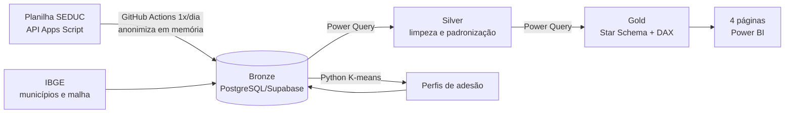

# Monitoramento do Recadastramento SEDUC-MT

Projeto Extensionista Integrador VI, Implementação de Inteligência de Negócios (UNIVAG, 2026/2). Professor orientador: Germano Manente Neto.

Painel de BI que acompanha, **de forma agregada e anonimizada**, o recadastramento dos servidores da Secretaria de Estado de Educação de Mato Grosso:
- onde o recadastramento está atrasado (DRE, município e escola);
- que tipos de atraso existem (perfis de adesão);
- se a meta (90% concluído até 31/12/2026) será cumprida no prazo.

## Arquitetura (Medallion)



| Camada | Onde | O que faz |
|---|---|---|
| Bronze | Supabase, schema `bronze` | Carga diária anonimizada (7 dias), histórico SCD Tipo 2 e views SQL de extração |
| Silver | Power Query | Padronização, situações oficiais, de-para de municípios, código IBGE e qualidade de dados |
| Gold | Modelo do Power BI | Star Schema (1 fato e 7 dimensões), hierarquia DRE > Município > Lotação e medidas DAX |

## Painéis

| Página | Para quem | O que mostra |
|---|---|---|
| Gerencial | Gestão e DREs | Cartões por situação, mapa de % concluído, situação por DRE, vínculo, lotação e funções |
| Operacional | Equipe do recadastramento | Matriz DRE > Município > Lotação, ordenada pelo menor % concluído, e ranking na DRE |
| Estratégico | Gestão da SEDUC | Evolução diária, média móvel, projeção e acompanhamento da meta |
| Perfis de adesão | Gestão da SEDUC | Municípios agrupados por perfil (mineração de dados) e ação sugerida para cada perfil |

## Estrutura do repositório

```
.github/workflows/carga-diaria.yml   carga diária agendada (GitHub Actions)
ingestao/                            leitura da API ou de CSV, anonimização e gravação na Bronze (+ testes)
sql/01_bronze.sql                    tabelas, histórico SCD2 e função de atualização
sql/02_extracao.sql                  views de extração (CTEs, funções de janela)
sql/03_referencia_municipios.sql     municípios de MT com código IBGE
sql/04_perfil_municipio.sql          tabela dos perfis de adesão
sql/05_exploracao.sql                consultas exploratórias (volume, nulos, inconsistências)
mineracao/                           clusterização K-means dos municípios
powerbi/                             Power BI Project (.pbip): modelo (TMDL) e relatório (PBIR)
dados/exemplo/                       amostra FICTÍCIA no formato da planilha
docs/                                documentação técnica
```

## Documentação

- [Inventário das fontes](docs/inventario-fontes.md)
- [Requisitos analíticos](docs/requisitos-analiticos.md)
- [Catálogo de indicadores](docs/catalogo-indicadores.md)
- [Modelo dimensional (conceitual, lógico e dicionário)](docs/modelo-dimensional.md)
- [ETL: regras de tratamento por camada](docs/etl.md)
- [Mineração de dados: perfis de adesão](docs/mineracao.md)

## Como executar

1. **Banco:** no SQL Editor do Supabase, rode `sql/01` a `sql/04`, nessa ordem.
2. **Carga:** configure os Secrets do repositório (`RECADASTRAMENTO_API_URL`, `RECADASTRAMENTO_API_TOKEN`, `CHAVE_ANONIMIZACAO`, `DATABASE_URL`). O workflow roda todo dia às 23h (Cuiabá) ou manualmente, em *Actions → Run workflow*.
   - Localmente, crie um `.env` a partir do `.env.example` e rode:
     ```
     pip install -r ingestao/requirements.txt
     python ingestao/carregar_bronze.py
     ```
   - Para testar a leitura sem banco, use a amostra fictícia com `ARQUIVO_PLANILHA=dados/exemplo/recadastramento_exemplo.csv` e rode os testes com `python -m unittest discover -s ingestao`.
3. **Perfis de adesão:**
   ```
   pip install -r mineracao/requirements.txt
   python -m mineracao.clusterizar_municipios --gravar
   ```
4. **Power BI:**
   - Abra `powerbi/PEI.pbip` no Power BI Desktop.
   - Ligue o recurso em versão prévia "Visual de mapa de formas".
   - Entre no PostgreSQL com o usuário somente leitura `leitor_pei` e clique em **Atualizar**.

## Escolha das tecnologias

| Necessidade | Escolha | Alternativas consideradas | Motivo |
|---|---|---|---|
| Base analítica | PostgreSQL no Supabase | SQL Server local; ler a planilha direto | Gratuito, na nuvem e acessível pelo GitHub Actions e pelo Power BI. Guarda o histórico que a planilha não tem e isola o dado pessoal antes de entrar na base |
| Agendamento da carga | GitHub Actions | Agendador do Windows num PC pessoal | Roda sem depender de um computador ligado, guarda os segredos em Secrets e é gratuito para repositório público |
| Linguagem da carga | Python (psycopg) | Power Query direto na API | A anonimização precisa acontecer **antes** de gravar, e o token não pode ficar no arquivo do Power BI |
| ETL Silver e Gold | Power Query | Views SQL | Pedido pelo PEI. Deixa cada regra visível e auditável no Power BI |
| Visualização e OLAP | Power BI Desktop | Painel web | Pedido pelo PEI. Oferece modelo semântico, DAX, drill-down e mapas |
| Versionamento do BI | `.pbip` (TMDL/PBIR) | `.pbix` | Arquivos de texto: o git mostra o que mudou e o repositório não leva dados |
| Mineração | Python (scikit-learn) | Clusterização nativa do Power BI | Reprodutível (semente fixa), com escolha de *k* pela silhueta e resultado gravado na base |

## LGPD

- Nome, matrícula e número do vínculo **nunca chegam ao banco**. O servidor é identificado por `HMAC-SHA256(chave secreta, matrícula|vínculo)`, um pseudônimo estável e irreversível sem a chave.
- Ficam só DRE, município, lotação, tipo de lotação, função, tipo de vínculo e situação.
- Os painéis mostram só contagens e percentuais.
- Este repositório não contém dados reais: só código, dados públicos do IBGE e uma amostra fictícia. O cache do Power BI e o `.env` ficam fora do git.

## Uso de inteligência artificial

Este projeto usou IA generativa como **ferramenta auxiliar**: **Claude** (Anthropic), por meio do Claude Code e do Claude Desktop com o Power BI Modeling MCP.

- **Onde ajudou:** na escrita de código Python, SQL, Power Query (M) e DAX, na montagem do relatório do Power BI e na redação desta documentação.
- **Responsabilidade do aluno:** as decisões de escopo, de modelagem e de layout, a validação dos resultados com os dados e a revisão de todo o conteúdo.
