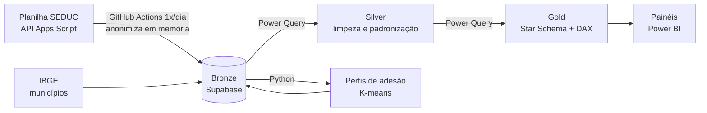

# ETL: regras de tratamento por camada

## Fonte → Bronze (`ingestao/carregar_bronze.py`)

| Nº | Regra | Por quê |
|---|---|---|
| B1 | O cabeçalho precisa ter todas as colunas esperadas (comparação sem acento e sem diferença de caixa); senão, a carga para | Detectar mudança na planilha antes de gravar dado errado |
| B2 | A coluna Nome nunca é lida | LGPD: minimização |
| B3 | `id_servidor = HMAC-SHA256(chave, matrícula\|vínculo)`; matrícula e vínculo não são gravados | LGPD: pseudonimização estável entre os dias |
| B4 | Linha sem matrícula é descartada e contada | Sem matrícula não há como identificar o servidor |
| B5 | Linha repetida (mesmo `id_servidor`) é descartada e contada | Garante 1 linha por servidor por dia |
| B6 | Espaços nas pontas são removidos | Evita valores "diferentes" só por espaço |
| B7 | Uma carga por dia, pela data de Cuiabá; se o dia já existe, nada é gravado | Idempotência |
| B8 | Carga, atualização do histórico e limpeza numa única transação | Nunca deixa a base pela metade |
| B9 | Histórico SCD Tipo 2: fecha a versão que mudou ou sumiu e abre a nova (`bronze.atualizar_historico`) | Guarda a evolução sem duplicar dias iguais |
| B10 | Cargas com mais de 7 dias são apagadas de `bronze.carga` | O histórico já guarda o necessário |
| B11 | Carga sem nenhuma linha válida não é gravada | Senão, fecharia o histórico de todos os servidores |
| B12 | Os logs mostram só contagens | Os logs do GitHub Actions são públicos |

## Bronze → extração (`sql/02_extracao.sql`)

| View | O que faz |
|---|---|
| `vw_snapshot_diario` | Expande o SCD2 em 1 linha por servidor por dia (CTE de calendário + `generate_series` + JOIN por intervalo de validade). Um dia sem carga repete o último estado conhecido |
| `vw_resumo_municipio` | Situação atual por DRE e município (GROUP BY com FILTER), % concluído e ranking dentro da DRE (`RANK() OVER`) |
| `vw_evolucao_diaria` | % concluído por dia, novos concluídos (`LAG`), média móvel de 7 dias e dias estimados para concluir |

## Bronze → Silver (Power Query, grupo "Silver")

| Nº | Regra | Função ou consulta | Colunas |
|---|---|---|---|
| S1 | Remove espaços nas pontas e repetidos, remove caracteres invisíveis (incluindo o espaço não separável) e põe em MAIÚSCULAS | `fn_padronizar` | dre, municipio, lotacao, tipo_lotacao, funcao, tipo_vinculo |
| S2 | Valor vazio vira "Não informado" | `silver_snapshot` | as mesmas, e situacao |
| S3 | Situação convertida para um dos 4 nomes oficiais, comparando sem acento e sem diferença de caixa (ex.: "nao iniciado" → "Não iniciado") | `fn_chave` + `silver_snapshot` | situacao |
| S4 | Situação fora dos 4 nomes é mantida e contada para revisão. Entra na `dim_situacao` com ordem 5 em diante, para o fato nunca ficar sem chave | `qualidade_dados`, `dim_situacao` | situacao |
| S5 | Município corrigido por um de-para revisado (`CONQUISTA DO OESTE` → `CONQUISTA D'OESTE`; `SANTO ANTONIO DO LEVERGER` → `SANTO ANTONIO DE LEVERGER`) | `correcoes_municipio` | municipio |
| S6 | Município casado com o IBGE por uma chave sem acento, sem apóstrofo e em minúsculas, recebendo `codigo_ibge` e o nome oficial | `fn_chave`, `municipios_mt_ibge` | municipio |
| S7 | Município sem código IBGE é listado para revisão manual (só contagem) | `municipio_de_para` | municipio |
| S8 | Cada regra registra quantas linhas corrigiu, rejeitou ou verificou | `qualidade_dados` | todas |

`Table.Buffer` é usado nas leituras do Supabase que depois são mescladas. Ele lê a tabela uma vez e impede que os passos seguintes sejam traduzidos para SQL (query folding), o que evitava um erro do conector.

## Silver → Gold (Power Query, grupo "Gold")

| Nº | Regra |
|---|---|
| G1 | Cada dimensão = valores distintos da Silver, ordenados, com chave substituta sequencial |
| G2 | `dim_municipio` vem da referência do IBGE (142 municípios), não da Silver: município sem servidor também aparece no mapa |
| G3 | `dim_lotacao` usa a chave natural lotação + município + DRE |
| G4 | O fato recebe as chaves por mesclagem (LeftOuter) e fica só com data, `id_servidor` e as chaves |
| G5 | Verificação após a carga: 0 chaves em branco e 0 linhas órfãs no fato; total do fato = total da Bronze no mesmo dia |
