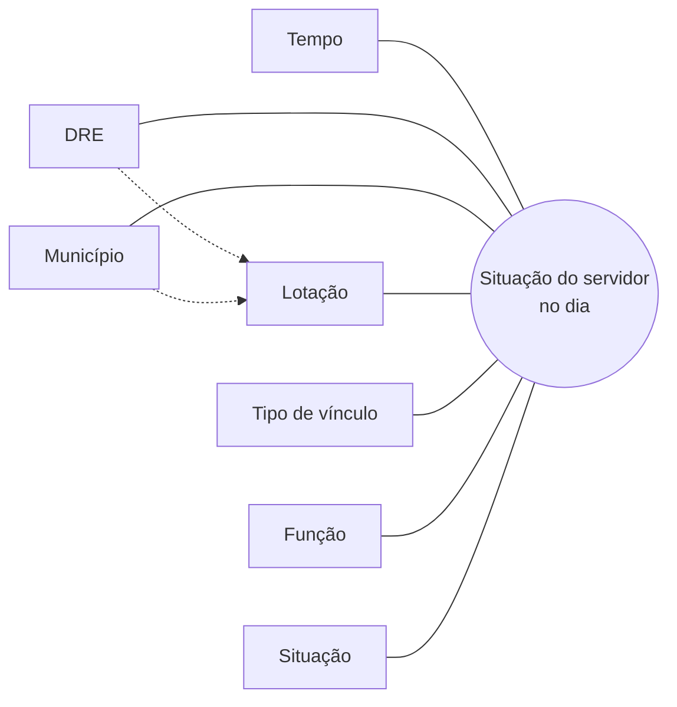
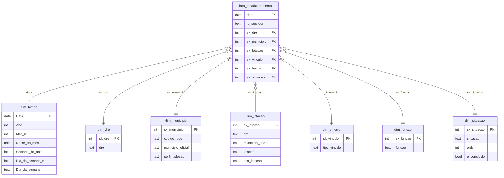

# Modelo dimensional (camada Gold)

O modelo está implementado no Power BI (`powerbi/PEI.SemanticModel`), no padrão **Star Schema**: um fato no centro, ligado a sete dimensões.

## Granularidade

**Uma linha por servidor anonimizado por dia.** Cada dia é uma foto completa (snapshot periódico), gerada pela view `bronze.vw_snapshot_diario`, que expande o histórico SCD Tipo 2.

Consequência: as contagens são **semiaditivas no tempo**. Elas somam entre DREs, municípios e situações, mas **nunca entre dias**. Todas as medidas usam o último dia com carga no período filtrado (`[Última data]`).

## Modelo conceitual

- **Fato:** a situação de recadastramento de um servidor num dia.
- **Dimensões, as perguntas que se faz ao fato:** quando (Tempo), onde (DRE, Município, Lotação), quem, por categoria (Vínculo, Função) e em que etapa (Situação).
- **Hierarquia de lugar:** DRE → Município → Lotação. A DRE é atributo da **lotação**, não do município: um município pode ter lotações em DREs diferentes (ex.: Cuiabá, no Órgão Central e na DRE Metropolitana).

## Modelo lógico

**Relacionamentos:** 7, todos muitos-para-um (fato → dimensão), com filtro em direção única e ativos.

**Chaves substitutas (`sk_*`):** inteiros sequenciais gerados no Power Query (`Table.AddIndexColumn`), depois de ordenar a dimensão. Ficam ocultas no relatório. A `dim_tempo` usa a própria data como chave, como recomenda o Power BI para a tabela de datas.

## Dicionário de dados

### fato_recadastramento

| Coluna | Tipo | Origem | Descrição |
|---|---|---|---|
| data | data | `vw_snapshot_diario.data` | Dia da foto |
| id_servidor | texto (64) | HMAC-SHA256(matrícula\|vínculo) | Pseudônimo do servidor; oculto; só para contagem distinta |
| sk_dre, sk_municipio, sk_lotacao, sk_vinculo, sk_funcao, sk_situacao | inteiro | Mesclagem com as dimensões | Chaves estrangeiras; ocultas |

### Dimensões

| Tabela | Coluna | Tipo | Origem | Descrição |
|---|---|---|---|---|
| dim_tempo | Data | data | Calendário contínuo do 1º ao último dia da Silver | Chave; marcada como tabela de datas |
| | Ano, Mês nº, Nome do mês, Semana do ano, Dia da semana nº, Dia da semana | inteiro/texto | Derivadas da data (pt-BR) | Nomes ordenados pelos números (ocultos) |
| dim_dre | dre | texto | `silver_snapshot.dre` | 13 DREs + Órgão Central |
| dim_municipio | codigo_ibge | texto (7) | `bronze.municipio_ibge` | Código IBGE; usado pelos mapas |
| | municipio_oficial | texto | `bronze.municipio_ibge` | Nome oficial; categoria Cidade |
| | perfil_adesao | texto | `bronze.municipio_perfil` | Perfil da mineração (ver `mineracao.md`) |
| dim_lotacao | dre, municipio_oficial, lotacao | texto | `silver_snapshot` | Chave natural composta (o nome da escola se repete entre municípios) |
| | tipo_lotacao | texto | `silver_snapshot` | Escola, Escola Campo, Escola Indígena, Educação Especial, DRE, Órgão Central |
| dim_vinculo | tipo_vinculo | texto | `silver_snapshot` | Efetivo, Temporário |
| dim_funcao | funcao | texto | `silver_snapshot` | Função exercida |
| dim_situacao | situacao | texto | Lista fixa + valores fora do padrão | Não iniciado, Em andamento, Aguardando validação, Concluído |
| | ordem | inteiro | Lista fixa | Ordem do fluxo (1 a 4); valores fora do padrão recebem 5 em diante |
| | e_concluido | booleano | Lista fixa | Verdadeiro só para Concluído |

### Hierarquia (drill-down OLAP)

`dim_lotacao`: **DRE > Município > Lotação**. Para não combinar dois filtros de DRE ao mesmo tempo, as segmentações usam `dim_dre` e o drill-down usa a hierarquia.

### Medidas

As medidas DAX ficam na tabela `_Medidas`, organizadas em pastas: Situação, Mapa, Evolução, Ranking, Meta, Perfis e Exibição. O mapeamento de cada uma a uma pergunta de negócio está em [`catalogo-indicadores.md`](catalogo-indicadores.md).
